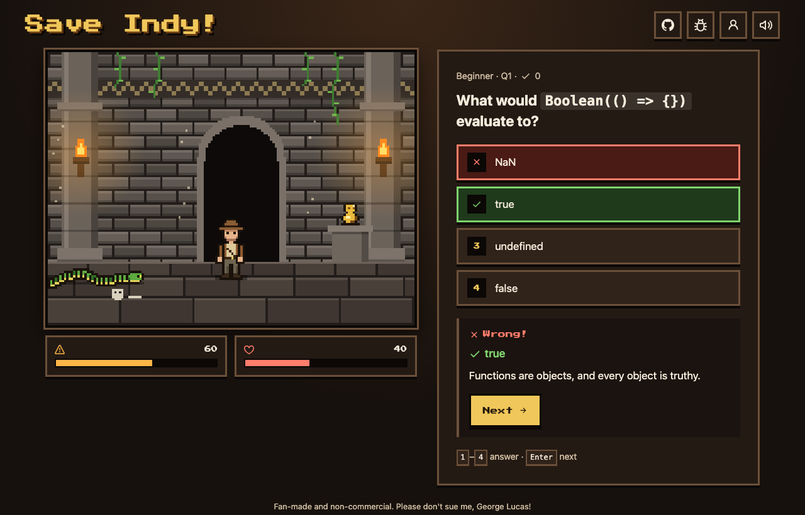

# Save Indy!

A retro browser game that tests your JavaScript knowledge: answer correctly to
drive the snake back and save Indy.

**[Play it in your browser →](https://www.indrapatil.com/save-indy/)**

## How to play

1. Pick a level: **Beginner**, **Intermediate**, or **Advanced**.
2. Answer each multiple-choice question with a click, a tap, or the keys
   <kbd>1</kbd>–<kbd>4</kbd>.
3. Read the explanation, then press <kbd>Enter</kbd> for the next question.

| Answer | Indy            | Snake   | Threat | Health |
| ------ | --------------- | ------- | ------ | ------ |
| Right  | Cracks his whip | Recoils | −10    | +10    |
| Wrong  | Flinches        | Lunges  | +10    | −10    |

You win when the threat reaches 0 and the snake flees; you lose when Indy's
health reaches 0. Both start at 50.

If a level runs out of questions first, the round ends undecided. The end screen lists
every missed question with its answer and explanation.

## Features

- Pixel-art temple, explorer, and snake drawn in code, with animated torches,
  whip cracks, and strikes
- Sound effects synthesised with the Web Audio API, with a mute toggle that is
  remembered
- An explanation for every answer, and a review of missed questions
- Keyboard play, screen-reader announcements, visible focus, and reduced
  motion support
- A static site with no runtime dependencies beyond a self-hosted font, served
  under a strict Content Security Policy

## Development

The game is a TypeScript single-page app built with [Vite+](https://viteplus.dev/)
(`vp`), which also manages Node.js (from `.node-version`) and pnpm (from
`packageManager` in `package.json`).

| Task                                 | Command                            |
| ------------------------------------ | ---------------------------------- |
| Install dependencies                 | `vp install`                       |
| Start the dev server with hot reload | `vp dev`                           |
| Run every check, as CI does          | `vp run qa`                        |
| Format, lint, and type-check         | `vp check`                         |
| Unit tests in Chromium               | `vp test`                          |
| Build and run end-to-end tests       | `vp run test:e2e`                  |
| Build and preview production assets  | `vp run preview`                   |
| Lighthouse audit of the build        | `vp run lighthouse`                |
| Re-render PNG icons and social image | `vp build && vp run render-assets` |

### Project structure

| Path                       | Contents                                                    |
| -------------------------- | ----------------------------------------------------------- |
| `index.html`               | Page markup: scene, stats, and the three screens            |
| `src/questions.ts`         | The question bank, with an explanation for every answer     |
| `src/game.ts`              | Pure game rules: scoring, outcomes, and question order      |
| `src/app.ts`, `view.ts`    | The controller and the DOM rendering it drives              |
| `src/scene/`               | Pixel art, sprites, and the animated canvas scene           |
| `src/audio.ts`             | Synthesised sound effects                                   |
| `e2e-tests/`               | Playwright gameplay tests and axe accessibility audits      |
| `public/`                  | Icons, web manifest, social image, and the old-URL redirect |
| `scripts/render-assets.ts` | Renders the PNG icons and social image from the game        |

### Quality gates

`vp run qa` runs the same gates as the [QA workflow](.github/workflows/qa.yml):

| Gate                       | Tool                                                         |
| -------------------------- | ------------------------------------------------------------ |
| Formatting, lint, types    | Oxfmt and type-aware Oxlint with every rule category on      |
| CSS lint                   | Biome                                                        |
| Unit tests                 | Vitest in real Chromium, with coverage thresholds            |
| Dead code and complexity   | Fallow                                                       |
| Type coverage              | `type-coverage` at 100%                                      |
| Dependency audit           | `pnpm audit` at moderate severity                            |
| Gameplay and accessibility | Playwright with axe-core (WCAG 2.2 AA) on desktop and mobile |
| Web quality                | Lighthouse CI (in the QA workflow)                           |

### Adding a question

Add an entry to `src/questions.ts` with a level, a prompt, four distinct
answers, the correct one, and a one-sentence explanation. Wrap code in
backticks to show it as inline code. The unit tests check that every question
is well-formed and that each level has enough questions to finish a round.

## Deployment

Every push to `main` builds the site and publishes `dist/` to GitHub Pages via
the [Deploy workflow](.github/workflows/deploy.yml).

## Credits

Most questions are inspired by:

- Flanagan, D. (2020). _JavaScript: The Definitive Guide_ (7th Edition). O'Reilly.
- Padolsey, J. (2020). _Clean Code in JavaScript_. Packt Publishing.
- Brian Leroux's [WAT talk](https://www.youtube.com/watch?v=et8xNAc2ic8&t=1s).

Any inaccuracies are mine; please
[report them](https://github.com/IndrajeetPatil/save-indy/issues).

The artwork and sounds are original to this game. The
[Press Start 2P](https://fonts.google.com/specimen/Press+Start+2P) font is by
CodeMan38, under the SIL Open Font License.

## License

[CC0 1.0](LICENSE). Please note that this project is released with a
[Contributor Code of Conduct](.github/CODE_OF_CONDUCT.md). By participating in
this project you agree to abide by its terms.
