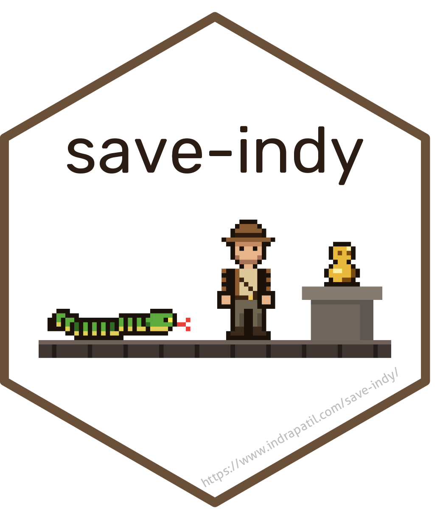

# Save Indy! 

A retro browser game that tests your JavaScript knowledge: answer correctly to
drive the snake back and save Indy.

**[Play it in your browser →](https://www.indrapatil.com/save-indy/)**

> [!IMPORTANT]
> This is an unofficial, non-commercial fan project made purely for
> educational purposes. See the [disclaimer](#disclaimer).

## How to play

1. Pick a level: **Beginner**, **Intermediate**, or **Advanced**.
2. Answer each multiple-choice question with a click, a tap, or, while the
   question has focus, the keys <kbd>1</kbd>–<kbd>4</kbd>.
3. Read the explanation, then press <kbd>Enter</kbd> for the next question.

| Answer | Indy            | Snake   | Threat | Health |
| ------ | --------------- | ------- | ------ | ------ |
| Right  | Cracks his whip | Recoils | −10    | +10    |
| Wrong  | Flinches        | Lunges  | +10    | −10    |

You win when the threat reaches 0 and the snake flees; you lose when Indy's
health reaches 0. Both start at 50.

If a level runs out of questions first, the round ends undecided. The end screen lists
every missed question with its answer and explanation.

## Features

- Three levels of JavaScript questions, from type coercion to Unicode strings
- An explanation for every answer, and a review of missed questions at the end
- A pixel-art temple with flickering torches, whip cracks, and snake strikes
- Synthesised sound effects (a whip crack, a snake hiss, and brass for the
  ending), with a mute toggle that is remembered; on iPhone the sound plays
  even with the silent switch on
- Works on phones: the scene and meters stay pinned above the quiz
- Keyboard play, screen-reader announcements, visible focus, and reduced
  motion support

## Privacy

The game keeps only your mute setting, in your browser. Visits are counted
with Google Analytics, as on every page of
[indrapatil.com](https://www.indrapatil.com/privacy/); your answers are never
sent anywhere.

## Contributing

Found a wrong answer or have a question to add? Please
[open an issue](https://github.com/IndrajeetPatil/save-indy/issues) or a pull
request. The [development guide](docs/development.md) covers running the game
locally, the checks, and how to add a question.

## Credits

Most questions are inspired by:

- Flanagan, D. (2020). _JavaScript: The Definitive Guide_ (7th Edition). O'Reilly.
- Padolsey, J. (2020). _Clean Code in JavaScript_. Packt Publishing.
- Haverbeke, M. (2024). [_Eloquent JavaScript_](https://eloquentjavascript.net/) (4th Edition). No Starch Press.
- Simpson, K. [_You Don't Know JS Yet_](https://github.com/getify/You-Dont-Know-JS) (2nd Edition), especially _Get Started_ and _Scope & Closures_.
- MDN Web Docs' [JavaScript reference](https://developer.mozilla.org/en-US/docs/Web/JavaScript/Reference).
- Brian Leroux's [WAT talk](https://www.youtube.com/watch?v=et8xNAc2ic8&t=1s).

Any inaccuracies are mine; please
[report them](https://github.com/IndrajeetPatil/save-indy/issues).

Interface icons are from GitHub's [Octicons](https://github.com/primer/octicons)
(MIT License). The artwork and sounds are original to this game. The
[Press Start 2P](https://fonts.google.com/specimen/Press+Start+2P) font is by
CodeMan38, under the SIL Open Font License.

## Disclaimer

- _Save Indy!_ is an unofficial fan project, made purely to help people
  learn JavaScript.
- It is free, has no ads or payments, and makes no money.
- Indiana Jones is a trademark of Lucasfilm Ltd. This project is not
  affiliated with, endorsed by, or sponsored by Lucasfilm Ltd. or The Walt
  Disney Company.
- All artwork and sounds are original; no material from the films or games is
  used.
- If you are a rights holder with a concern, please
  [open an issue](https://github.com/IndrajeetPatil/save-indy/issues) and it
  will be addressed promptly.

## License

The code and original assets are released under [CC0 1.0](LICENSE); the
license does not extend to third-party trademarks.

Please note that this project is released with a
[Contributor Code of Conduct](.github/CODE_OF_CONDUCT.md). By participating in
this project you agree to abide by its terms.
