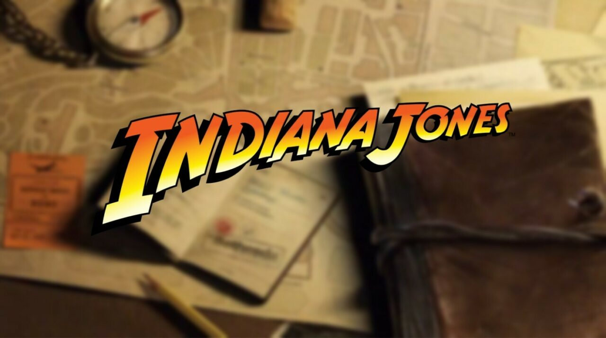

# Save Indiana Jones using JavaScript



A fun game built using JavaScript to check your knowledge of JavaScript itself! 🔄

**[Play it in your browser →](https://www.indrapatil.com/save-indy/)**

## Rules


Three different levels correspond to proficiency levels
(_beginner_, _intermediate_, and _advanced_). That said, there are
far more questions available for the beginner level. There
are plans to add more questions for the other levels as well.

- You will win the game when the threat level drops to 0.
- You will lose the game if Indy's health drops to 0.

## References

Most of the questions are inspired by the following material:

- Flanagan, D. (2020). _JavaScript: The Definitive Guide_ (7th Edition). O'Reilly.
- Padolsey, J. (2020). _Clean Code in JavaScript_. Packt Publishing.
- Brian Leroux's [WAT talk](https://www.youtube.com/watch?v=et8xNAc2ic8&t=1s)

Needless to say, any inaccuracies reflect my poor judgment, and I would appreciate
[feedback](https://github.com/IndrajeetPatil/save-indy/issues) with
corrections/suggestions.

## Development

The game is plain HTML, CSS and JavaScript with [p5.js](https://p5js.org/) loaded from a CDN, so there is no build step. Serve the repository root with any static file server (e.g. `python3 -m http.server`) and open `index.html`.

To lint and check formatting:

```sh
npm ci
npm run lint
```

## Acknowledgments

The game was my submission for the third-week project for the IronHack boot camp
on web development (full-time, Berlin, Jan-March 2023). I would love to thank
my instructors for their help, and my batchmates for their company and support!

## Code of Conduct

Please note that this project is released with a [Contributor Code of
Conduct](https://www.contributor-covenant.org/version/2/1/code_of_conduct/).
By participating in this project you agree to abide by its terms.
